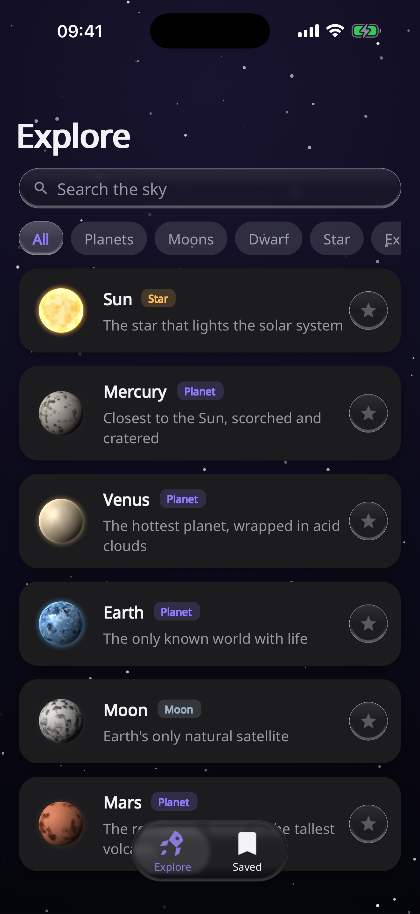
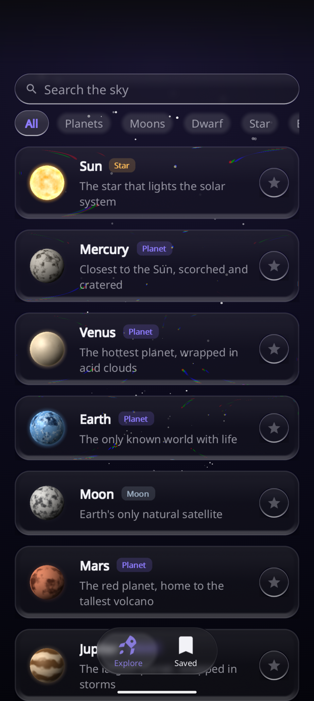
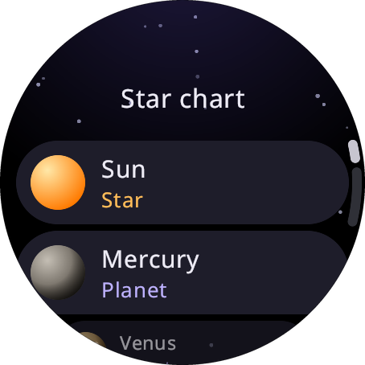
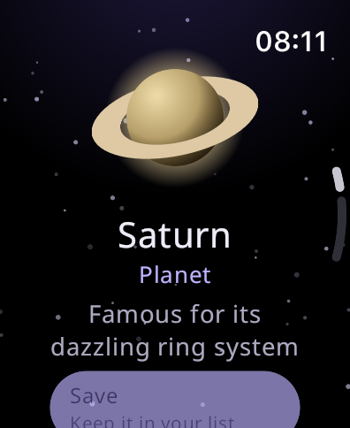

https://github.com/user-attachments/assets/2e4cc01c-9230-4417-917b-b4491a27e13c


# Showcase Cranpose

**Live demo:** <https://samoylenkodmitry.github.io/cranpose-showcase/>

Showcase Cranpose is a liquid-glass 3D star chart built with
[Cranpose](https://github.com/samoylenkodmitry/cranpose). One Rust codebase
builds the app for Linux, macOS and Windows, the web, Android phones, Wear OS
watches, iPhone and iPad, and Apple Watch. It is also the template from which
to start a Cranpose app: every target below has its commands and a CI job.

<table>
<tr>
<td align="center"><b>iOS</b></td>
<td align="center"><b>Android</b></td>
<td align="center"><b>Wear OS</b></td>
<td align="center"><b>Apple Watch</b></td>
</tr>
<tr>
<td></td>
<td></td>
<td valign="top"></td>
<td valign="top"></td>
</tr>
</table>

## Targets

| Target | Build on | Command | What you get |
|---|---|---|---|
| Linux, macOS, Windows | that system | `cargo run --release` | a window |
| Web | any system | `./build-web.sh` | `dist/`, a static site |
| Android phone | any system | `cd android && ./gradlew :app:assembleDebug -PshowcaseAbi=arm64-v8a` | `android/app/build/outputs/apk/debug/app-debug.apk` |
| Wear OS | any system | `cd android && ./gradlew :wear:assembleDebug -PshowcaseAbi=armeabi-v7a` | `android/wear/build/outputs/apk/debug/wear-debug.apk` |
| iPhone and iPad simulator | a Mac | `./ios/run-sim.sh` | the app running in the simulator |
| iPhone and iPad | a Mac | `PROFILE=release WITH_WATCH=1 ./ios/build-app.sh aarch64-apple-ios` | `target/aarch64-apple-ios/release/CranposeShowcase.app`, with the watch app inside |
| Apple Watch simulator | a Mac | `python3 watchos/build.py --smoke` | `target/watchos/simulator/CranposeWatch.app` and a screenshot in `target/watchos/simulator/evidence` |
| Apple Watch | a Mac | `python3 watchos/build.py --target device` | `target/watchos/device/CranposeWatch.app`, unsigned |
| TestFlight | GitHub Actions | the **TestFlight** workflow | a build in TestFlight; see [docs/testflight.md](docs/testflight.md) |
| The watch app on the desktop | any system | `cargo run --features watch` | a 227 by 227 point window with the watch app |

`-PshowcaseAbi` picks the processor of the APK: `arm64-v8a` for phones and
for emulators on Apple Silicon, `x86_64` for emulators on Intel and AMD (the
default), `armeabi-v7a` for most Wear OS watches. Install an APK with
`adb install -r <file>.apk`.

## First build

You need nothing but Rust and a C toolchain for the desktop app.

1. Install the C toolchain. On macOS run `xcode-select --install`. On Ubuntu
   or Debian run `sudo apt install build-essential`. On Windows install
   **Visual Studio Build Tools** with **Desktop development with C++**; the
   Rust installer offers to do it.
2. Install Rust with rustup from <https://rustup.rs>. On macOS and Linux:

   ```sh
   curl --proto '=https' --tlsv1.2 -sSf https://sh.rustup.rs | sh
   ```

   On Windows, download and run `rustup-init.exe` from the same page. Open a
   new terminal afterwards, so that `cargo` is on the path.
3. Get the code and run it:

   ```sh
   git clone https://github.com/samoylenkodmitry/cranpose-showcase
   cd cranpose-showcase
   cargo run --release
   ```

The first build downloads and compiles several hundred crates and takes
several minutes. Later builds are quicker. Then a window opens with the star
chart: a list of planets and moons, each drawn by a shader. Click one to open
its page. Widen the window past 880 points and the list and the page sit
side by side. `cargo run` without `--release` builds faster and runs slower.

Each other target needs some more tools:

- **Web**: `rustup target add wasm32-unknown-unknown` and
  `cargo install wasm-pack`. Serve the result with
  `cd dist && python3 -m http.server 8080` and open
  <http://localhost:8080>.
- **Android phone and Wear OS**: the Android SDK and NDK 28 (install
  [Android Studio](https://developer.android.com/studio), then the NDK from
  its SDK Manager), JDK 17, `cargo install cargo-ndk`, and
  `rustup target add aarch64-linux-android armv7-linux-androideabi x86_64-linux-android`.
  Set `ANDROID_HOME` to the SDK and `ANDROID_NDK_HOME` to the NDK. Android
  Studio's Device Manager makes phone and Wear OS emulators.
- **iPhone, iPad and Apple Watch**: a Mac with Xcode, and
  `rustup target add aarch64-apple-ios aarch64-apple-ios-sim aarch64-apple-watchos aarch64-apple-watchos-sim`.
  The Apple Watch app needs Xcode 27 or newer for watches (Xcode 26 builds an
  app that runs on a watch and that the App Store refuses), the watchOS
  simulator (**Xcode > Settings > Components**) and Python 3.11 or newer. No
  Xcode project is involved: the scripts build the apps from the command line.
- **A real iPhone or Apple Watch**: an Apple Developer account and signing;
  [docs/testflight.md](docs/testflight.md) goes through it for TestFlight.

## What it demonstrates

- Liquid Glass surfaces with zero material blur, refraction, a pinned
  blurred-gradient crown, and a floating tab bar.
- A procedural WGSL planet shader with lighting, atmosphere, terrain, cloud,
  and ring variants.
- Compose-style state, keyed lazy lists, scroll-linked parallax, transitions,
  and platform safe-area handling.
- `NavHost` navigation and composable-scoped view models: see
  [App architecture](#app-architecture-composable-scoped-view-models).
- One layout that splits into a list column and a detail pane on a desktop
  window and folds back to a single column on a phone, holding a row to a
  readable width at every size.

## The watch app

The watches run their own small UI, `WatchShowcase` in `src/watch`, built
for a round screen of about 450 pixels. It lists the bodies of the phone app
in a Wear scaling list (`WearScalingLazyColumn`): the crown or the rotating
bezel scrolls it, and rows shrink and fade towards the edge. A tap opens a
body's page, and a swipe from the left edge goes back. The page uses the same
`BodyCardViewModel` as a card on the phone, for saving the body and for its
fact.

- **Wear OS**: `android/wear` builds the same Rust library with the `watch`
  Cargo feature, which makes `WatchShowcase` the root composable in
  `src/lib.rs`. The phone app in `android/app` builds it without the feature.
  Both APKs have the application id `com.cranpose.showcase`, so Google Play
  lists them as one app; the watch build's version code is the phone's plus
  one million.
- **Apple Watch**: `[package.metadata.cranpose.watchos]` in `Cargo.toml`
  names `watch::WatchShowcase`, the bundle id and the icon. `watchos/build.py`
  finds the Cranpose version in `Cargo.lock` and runs its watchOS packager,
  which writes the SwiftUI host and the Rust runner. The repository has no
  Swift code and no Xcode project. The watch app ships inside the iPhone app
  and also runs without it.

The Apple Watch host draws through SpriteKit with Cranpose's pixel renderer,
which runs none of the app's own shaders, and the watch UI uses no Liquid
glass and no planet shader for that reason: its bodies are circles and
gradients, the same on both watches. `cargo run --features watch` shows it in a desktop window, where the
mouse wheel stands in for the crown. The launch argument `--body=saturn`
opens a body's page, for screenshots:
`cargo run --features watch -- --body=saturn`, or
`xcrun simctl launch <watch> io.cranpose.showcase.watchkitapp --body=saturn`.

## App architecture: composable-scoped view models

The showcase is also the template for how a Cranpose app is structured. It
follows the Android architecture guide, with coroutines and flows from
[`coroflow`](https://crates.io/crates/coroflow):

| Layer | Where | What it holds |
|---|---|---|
| Data | `src/data` | `Favorites` (a repository) and `FactSource` (a remote-like API), built once in `AppServices` |
| Presentation | `src/presentation` | View models: state as `StateFlow`s, user intents as methods, no Cranpose imports |
| UI | `src/screens`, `src/app.rs` | Composables that collect state and call intents |

Three pieces make parts of the UI self-contained:

- **A view model store per screen.** `NavHost` gives every back stack entry
  its own `ViewModelStore`. The screen's view models live until the entry is
  popped, not just while the screen is composed.
- **Keyed view models for parts of a screen.** `BodyCard(index, ..)` resolves
  its own `BodyCardViewModel` with `viewModel(index, |scope| ..)`. The list
  only passes the body's index; the card owns its logic (saving, fetching a
  fact). Because the view model lives in the screen's store, a card scrolled
  out of view and back keeps its fact instead of fetching it again.
- **A screen-scoped bus.** `ScreenMessages` is itself a view model in the
  screen's store (`viewModel((), |_| ScreenMessages::default())`). The screen
  and each card get the same instance without knowing about each other, and
  the screen shows what the cards send as a toast.

For a part that should lose its state when it closes, such as a dialog, wrap
it in `ViewModelStoreOwner(|| ..)`: its view models end with the block.

Tests follow the same split. `tests/view_models.rs` runs view models on
virtual time with `TestScheduler`. `tests/body_card.rs` composes the real
`BodyCard` inside `ProvideViewModelStore` with a store seeded with a view
model built from a fake fact source.

## Local platform packages

[Cranpose Build](https://github.com/samoylenkodmitry/cranpose-build) builds the
same application locally for desktop, Android and iOS. The checked-in
`CranposeBuild.toml` selects the iOS entry point, icon and Android ARM64 ABI.

```console
cranpose-build doctor --platform windows
cranpose-build setup --platform windows
cranpose-build build --platform windows
cranpose-build run --platform android --device emulator-5554
cranpose-build run --platform ios-sim --device <simulator-UDID>
```

Use `mac`, `linux` or their architecture variants for other desktop packages.
The tool also appears in Cranpose Studio's **Build for a platform** section.
Builds run on your computer; foreign desktop applications need their matching
OS or VM to run. iOS requires macOS/Xcode, and physical iOS devices require your
signing identity and provisioning profile. Android uses the project's existing
Gradle signing configuration. Packages are not automatically store releases.

## CI and releases

Every pull request runs `.github/workflows/check.yml`: the desktop tests on
Linux, macOS and Windows, the web bundle, the Android phone and Wear OS
APKs, the iOS app with the watch app inside it, and the Apple Watch app,
which it launches in a watch simulator and photographs. Each job keeps what
it built as a workflow artifact for a week. The Apple jobs run on GitHub's
`xcode-27` image.

To release, give the version in `Cargo.toml`, `android/app/build.gradle.kts`,
`android/wear/build.gradle.kts` and `ios/CranposeShowcase/Info.plist` the same
value, raise the version codes (the Wear OS one stays the phone's plus one
million), and push a tag `vX.Y.Z`. `scripts/verify-release-version.sh` checks
that the versions match. The release workflow then publishes the desktop
builds, the web bundle, the phone and Wear OS APKs, the unsigned iOS app with
the watch app inside, the iOS simulator app and the Apple Watch apps, and
the Pages workflow deploys the web demo. Uploads to TestFlight are a
separate workflow that you start by hand; see
[docs/testflight.md](docs/testflight.md).

## License

Apache-2.0. See [LICENSE](LICENSE).
